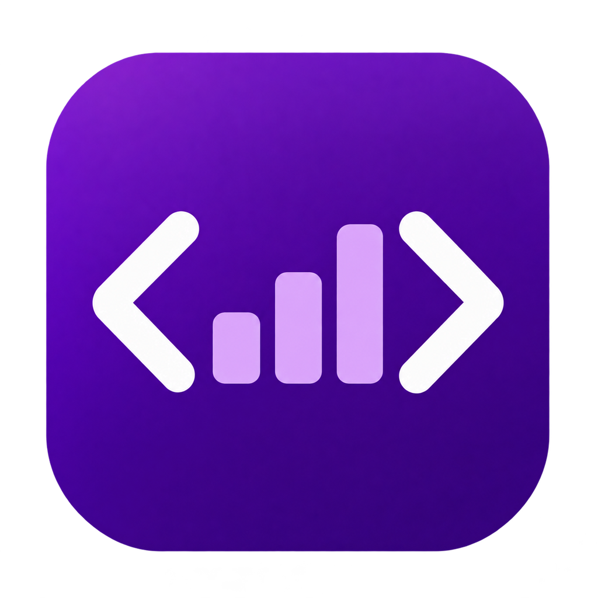

# Codex 用量看板









为 Codex 用户提供本机 Token 统计、额度快照和历史图表。支持 Windows 与 macOS，按北京时间汇总，用万和亿显示 Token。





## 选择版本





| 版本 | 适用场景 | 设备连接 |


| --- | --- | --- |


| Single 单设备版 | 仅在一台 Windows 或 Mac 使用 | 本机统计与刷新 |


| Sync 同步版 | 同账号 Windows 与 Mac 合并统计 | 首次配对后交换去重账本 |





两个版本均提供今日、近 7 天、近 30 天与自选日期范围。柱状图支持 Token 类型和模型分色，点击某一天联动显示当天用量与模型分布。额度窗口按实际接口结果展示，支持当前对话最近几轮用量与完成提醒。





公开候选版本为 `0.5.0-rc.2`。Windows 已有本机使用和安装验证，Mac 安装包在目标 Mac 上编译原生窗口。仓库中的 CI 负责进一步验证 Windows 与 macOS。目标 Mac 的原生安装、通知和真实双端跨网验收结果在实际测试后更新。





## 安装





从 [Releases](https://github.com/YushiroYukina/codex-usage-dashboard/releases) 选择操作系统和版本类型，校验 `SHA256SUMS` 后解压。





Windows 运行 `Install.cmd`，随后打开桌面对应快捷方式。需要 Windows 10/11、Microsoft Edge、Node.js 24+ 和已登录的 Codex。安装器会查找 Codex 自带的 Node。





Mac 运行 `bash /解压路径/Install-Mac.command`。需要 macOS 13+、Node.js 24+ 和已安装的 Codex。安装 Xcode 命令行工具后可编译原生窗口。单设备版支持浏览器入口回退，同步版还需要编译钥匙串助手。安装器生成的应用位于 `~/Applications`。





程序升级前退出旧账本应用。安装器沿用所选数据目录并创建 SQLite 备份。单设备版使用独立目录，详见安装说明。[安装与使用](docs/INSTALL.md)





## 同步版使用





在 Windows 的“设备与原生用量”创建连接码，将其粘贴到 Mac 连接。两端保持账本运行，点击“刷新用量”并等待确认状态。Windows 负责中转，每约 5 秒检查新增记录。





同步入口使用 Cloudflare 临时地址。Windows 或隧道重启后需要在 Mac 更新连接码。临时入口适合测试，持续可用性依赖第三方服务。配对码包含随机密钥，应只交给自己的另一台设备。[临时地址说明](https://developers.cloudflare.com/tunnel/get-started/quick-tunnels/)





## 数据口径





Token 来自本机可用的 Codex 用量元数据。累计计数按增量处理，以稳定事件编号去重。缓存输入是输入的子集，推理输出根据日志语义处理，缺失字段保留未知。日志覆盖范围随设备上的可用记录变化。





额度百分点来自实际查询快照，保留套餐原始标识。重置、套餐变更、读数回退、取整或采样缺口会影响可归因的消耗。原生账号累计 Token、原生日期桶和额度单列展示。完整说明见统计文档。[统计口径](docs/STATISTICS.md)





同步版合并两端明细，按账号过滤。双方确认相同修订和摘要后显示“两端一致”。单端发送完成显示待确认。当前配对支持一个 Windows 与一个 Mac。





## 开发与构建





源码按平台放在 `apps/windows` 和 `apps/mac`。两者保留平台安装器和原生入口，核心协议与图表代码同步维护。





```sh


node --test apps/windows/tests/*.test.mjs


node --test apps/mac/tests/*.test.mjs


python tools/build.py


```





构建器生成四个包及 `SHA256SUMS`，输出至 `artifacts`。同步版 Windows 构建需要 cloudflared，构建器从固定官方发行地址下载并核对 SHA-256。可以通过 `--cloudflared` 提供已验证的本地文件。





GitHub 发布步骤和验收边界见发布说明。[发布准备](docs/PUBLISH.md)





## 隐私与许可





项目只处理必要的用量元数据。设备连接密钥保存在 Windows DPAPI 或 macOS 钥匙串中。公开仓库通过构建白名单和忽略规则排除本机状态文件与账本。





项目遵循 MIT 许可证，保留 GPT-Niang 衍生代码的原始版权声明。随同步版 Windows 分发的 cloudflared 使用 Apache-2.0 许可证。[第三方声明](NOTICE.md)


